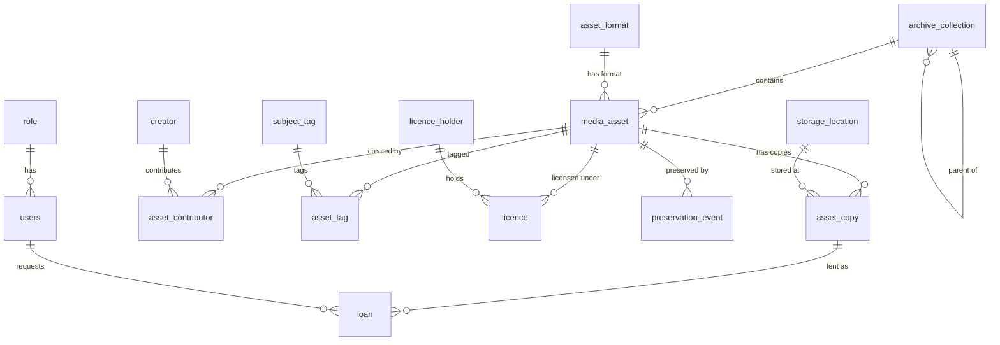

# MIT 8103 Advanced Database Systems — Course Assignment (CA)

**Student:** Chiamaka Ozurumba
**Matric:** 2026/A/MIT/1005
**Cohort:** Miva Open University, MIT, September 2026
**Topic:** Design and Implementation of an Advanced Digital Media Archive Management System
**Database:** `mediaarchive` (PostgreSQL 16 + MongoDB)
**Setting:** National broadcaster and film/music archive, Lagos, Nigeria

## Case study

The **National Digital Media Archive (NDMA), Lagos** is a national broadcaster archive that preserves, catalogues, licenses and lends out audio, video and photo assets. Assets originate from NTA Lagos studios, Nollywood production houses in Surulere, and highlife/afrobeat music labels in Yaba. Each asset has one or more physical or digital copies stored across sites (Ikeja, Victoria Island, Surulere). Each copy may be loaned to researchers and broadcasters under licences issued by rights holders.

The system captures: collections (self-referencing hierarchy), assets, formats, creators/contributors, subject tags, storage locations, asset copies, licences, licence holders, access (loan) requests, preservation events, and users with roles.

## ER diagram



## How to run

Run from the repo root on a GitHub Codespaces Ubuntu box with PostgreSQL 16 and MongoDB installed.

```bash
bash setup.sh
# Portfolio 1
psql -d mediaarchive -f portfolio-1-database-design/01_schema.sql
psql -d mediaarchive -f portfolio-1-database-design/02_indexes.sql
psql -d mediaarchive -f portfolio-1-database-design/03_seed_data.sql
psql -d mediaarchive -f portfolio-1-database-design/04_bulk_data.sql
psql -d mediaarchive -f portfolio-1-database-design/05_constraint_tests.sql
# Portfolio 2
psql -d mediaarchive -f portfolio-2-query-optimisation/01_analytical_queries.sql
psql -d mediaarchive -f portfolio-2-query-optimisation/02_explain_analyze.sql
# Portfolio 3
psql -d mediaarchive -f portfolio-3-transactions-concurrency/01_transactions.sql
python3 portfolio-3-transactions-concurrency/race_demos.py
# Portfolio 4
mongosh mediaarchive --quiet portfolio-4-nosql/01_setup_collections.js
mongosh mediaarchive --quiet portfolio-4-nosql/02_bulk_data.js
mongosh mediaarchive --quiet portfolio-4-nosql/03_aggregations.js
mongosh mediaarchive --quiet portfolio-4-nosql/04_index_demo.js
# Portfolio 5
psql -d mediaarchive -f portfolio-5-distributed-cloud/01_partitioning.sql
bash portfolio-5-distributed-cloud/02_replica_setup.sh
psql -p 5432 -d mediaarchive -f portfolio-5-distributed-cloud/03_replica_tests.sql
```

## Folder layout

- `docs/REFERENCES.md` — sources consulted.
- `docs/screenshots/README.md` — list of screenshots to capture.
- `portfolio-1-database-design/` — 3NF schema, 30+ indexes, seed + 60,000-row bulk load, constraint tests.
- `portfolio-2-query-optimisation/` — 8 analytical queries + EXPLAIN ANALYZE before/after indexes.
- `portfolio-3-transactions-concurrency/` — SQL transactions + threaded race demos (unique technique: btree_gist EXCLUDE).
- `portfolio-4-nosql/` — MongoDB collections, validators, 40k bulk docs, aggregations, index demo.
- `portfolio-5-distributed-cloud/` — monthly partitioning, streaming replica on port 5433, replica tests, cloud design.

## Note on AI use

This project was drafted with AI assistance and will be tested and corrected before final submission.

## Run everything in one go (Codespaces)
After setup.sh: `bash runall.sh` runs Portfolios 1-5 in order, commits each, and writes my_results.txt.
