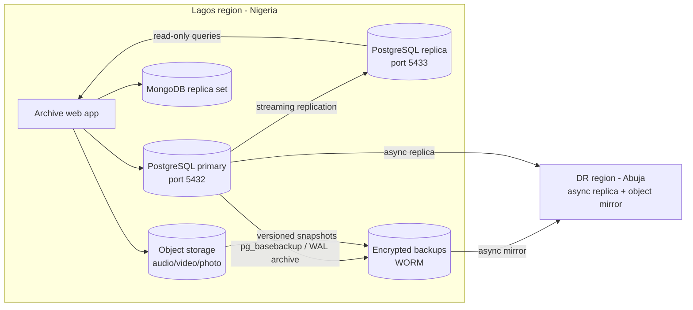

# Cloud Design — NDMA Media Archive (Portfolio 5)

**Student:** Chiamaka Ozurumba (2026/A/MIT/1005)

A short cloud design for hosting the National Digital Media Archive (NDMA) workload
described in the case study. It assumes a PostgreSQL primary + hot standby,
MongoDB for catalogue/access/preservation documents, and object storage for the
media files themselves.

## Architecture

## Data residency (NDPA 2023 and CBN rule)

The Nigeria Data Protection Act (NDPA) 2023 requires that personal data of
Nigerian data subjects be processed and stored in Nigeria unless an adequate
safeguard or lawful transfer basis exists. NDMA holds personal data in `users`
(researcher names, emails) and in `access_logs` (who borrowed what). To stay
compliant:

- The primary PostgreSQL, MongoDB replica set and object storage all run in a
  Lagos region (e.g. a local cloud region or an in-country data centre).
- No personal data crosses the Nigerian border for live processing. The DR
  copy in Abuja is still in-country.
- Backups are encrypted at rest (AES-256) and access-logged; only restore
  operators hold the keys, which are managed in a local KMS.
- A Data Protection Impact Assessment is recorded before any new collection
  ingests personal data, and retention/disposal follows the licence + loan
  policy (preservation logs are kept; expired loan rows are purged on schedule).

The Central Bank of Nigeria (CBN) data-residency guidance for regulated
institutions reinforces in-country storage of customer records. NDMA is not a
CBN-regulated entity, but where it ingests broadcaster content under CBN-licensed
media-house agreements, the same in-country principle is applied to those
assets to keep contractual alignment simple.

## Backups

- **Logical**: nightly `pg_dump` of `mediaarchive` to encrypted object storage,
  retained 30 days.
- **Physical**: continuous WAL archiving + a weekly `pg_basebackup` of the
  primary, retained 90 days for point-in-time recovery.
- **MongoDB**: `mongodump` of the three collections nightly plus oplog
  continuous replication within the replica set.
- **Object storage**: media files are versioned and snapshotted daily; corrupt
  or deleted assets are recoverable from any daily snapshot within 90 days.

## Disaster recovery

- The hot standby on port 5433 provides near-zero-RPO failover within Lagos.
- An asynchronous replica and object-storage mirror in Abuja provide a
  region-level DR target. RPO <= 5 minutes for the database, RTO <= 1 hour.
- Runbooks: primary failure -> promote the Lagos standby; Lagos region failure
  -> promote the Abuja async replica and repoint the app.

## Cost

- Compute: one primary (2 vCPU, 8 GB) + one standby (2 vCPU, 8 GB) + a small
  MongoDB replica set (3 x 1 vCPU, 4 GB). Estimated at roughly the local
  equivalent of USD 180-250 per month for compute.
- Storage: 500 GB database SSD + 5 TB object storage (media) + 200 GB backup
  bucket. Estimated roughly USD 120-180 per month for storage.
- Network: egress is minimised by serving reads from the Lagos standby and
  keeping all traffic in-country; cross-region mirror to Abuja is the main
  egress cost.
- Total indicative run-rate: about USD 300-450 per month, scalable with the
  media library size.

## Note

Drafted with AI assistance and will be tested and corrected before submission.
